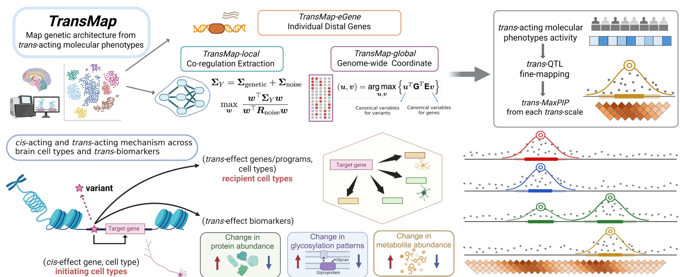

[](https://github.com/xueweic/transmap/actions/workflows/R-CMD-check.yml)

<p></p>


This R package implements TransMap---motivated and designed for mapping distal genetic effects on individual genes and co-regulatory programs across cell types---as a multi-scale framework that builds program phenotypes for *trans*-QTL mapping. At the local scale (TransMap-local), it detects co-expression gene modules with an R implementation of Hotspot and summarizes each module by whitened principal components that account for background expression variation. At the global scale (TransMap-global), it identifies sparse gene programs jointly associated with sparse sets of *trans* variants by penalized matrix decomposition of variant-gene association statistics (transCCA), and assesses these programs against a simulated null distribution. The resulting program phenotypes improve the detection of weak, coordinated distal genetic effects.

## Quick Start

### GitHub Installation
Install the development version from GitHub

```r
devtools::install_github("xueweic/transmap")
```

For a detailed installation guidance, please refer to [Installation](https://xueweic.github.io/transmap/articles/installation.html).


## Tutorial Website

Learn how to construct local and global program phenotypes for *trans*-QTL mapping with step-by-step examples. For detailed tutorials and use cases in [Tutorials](https://xueweic.github.io/transmap/articles/index.html).


## Citation

If you use TransMap in your research, please cite:

> Cao X, Wang Y, Sun H, Feng R, Zhang H, Li Y, Lee H, Karaahmet B, Li B, Gersbach C, Crawford G, Taga M, Beeri MS, Buchman AS, Klein HU, de Jager PL, Bennett D, The Alzheimer's Disease Functional Genomics Consortium, Wang G, Dey KK. (2026+). A multi-scale cell-type resolved map of *trans*-regulatory architecture in the aging human brain. medRxiv. [https://doi.org/10.64898/2026.11.05.26367384](https://doi.org/10.64898/2026.11.05.26367384)

Code and data to reproduce the figures in the manuscript are available at [transmap_paper](https://github.com/xueweic/transmap_paper).


## License

Copyright (c) 2026 Xuewei Cao. All rights reserved. A release license will be selected before public release; see [LICENSE](LICENSE).
