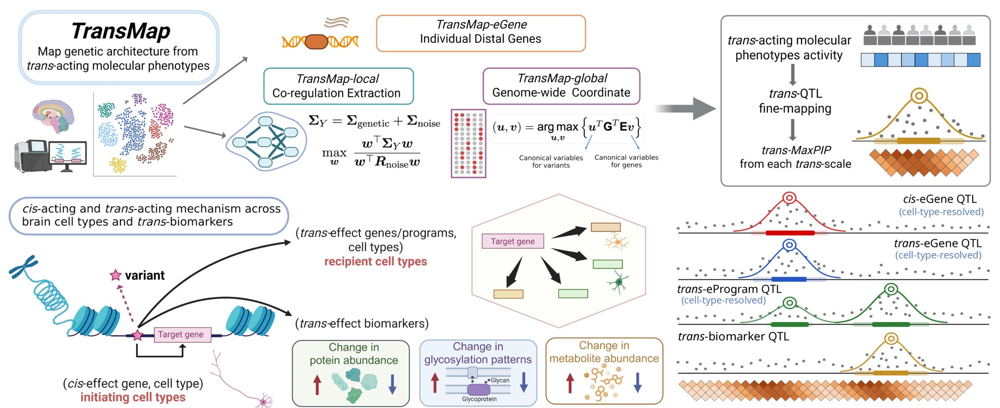

```{r, include = FALSE}
knitr::opts_chunk$set(
  collapse = TRUE,
  comment = "#>"
)
```

This vignette describes the statistical ideas behind TransMap. For the full
method and applications, see the
[manuscript](https://doi.org/10.64898/2026.11.05.26367384).

{width=100%}

# 1. Motivation

A genetic variant can act in *cis*, on a nearby target gene, and through that
gene in *trans*, on distal genes, co-regulated programs and downstream
biomarkers, possibly in other cell types. Individual *trans* effects are
typically weak and spread over many genes, so testing genes one at a time has
limited power. Many such effects are coordinated: the same variant shifts the
expression of a group of genes in the same direction. Summarizing those genes
into one phenotype pools their signal.

TransMap maps *trans*-acting molecular phenotypes at three scales:

| Scale | Phenotype | How it is built | In `transmap` |
|---|---|---|---|
| TransMap-eGene | Individual distal genes | Expression of each gene | (use `Y` directly) |
| TransMap-local | Co-regulatory programs | Co-expression modules, summarized while accounting for background expression variation | `r_hotspot()`, `transmap_local()` |
| TransMap-global | Genome-wide coordinated programs | Sparse gene sets jointly associated with sparse variant sets | `r_transcca()`, `transmap_global()` |

The phenotypes from every scale are then used as outcomes in *trans*-QTL
mapping and fine-mapping.

# 2. TransMap-local: co-regulation extraction

TransMap-local starts from gene modules that are co-expressed across samples,
detected with Hotspot (see [Hotspot Module Detection](Hotspot_Module_Detection.html)).

Module genes are correlated for many reasons besides the *trans* effect of
interest. Decompose the expression covariance of a module into a genetic part
and a background (noise) part,

$$\Sigma_Y = \Sigma_{\text{genetic}} + \Sigma_{\text{noise}}.$$

The first principal component of $\Sigma_Y$ is dominated by whichever source of
variation is largest, which is often background co-expression. Whitened
principal components (WPC) instead maximize variance relative to the
background correlation $R_{\text{noise}}$:

$$\max_w \frac{w^\top \Sigma_Y w}{w^\top R_{\text{noise}} w}.$$

The solution whitens standardized expression by $R_{\text{noise}}^{-1/2}$ and
takes principal components; components with eigenvalue above 1 carry more
variance than the background explains and are kept as program phenotypes.
$R_{\text{noise}}$ is estimated from null *trans* z-scores, i.e. the
gene-gene correlation of association statistics for variants with no effect
on the module (see [Local Program Phenotypes](Local_Program_Phenotypes.html)).

# 3. TransMap-global: genome-wide coordination

TransMap-global looks for groups of genes that share *trans* associations with
the same variants, anywhere in the genome. With standardized genotypes $G$
and expression $E$, the leading canonical pair of variants and genes solves

$$(u, v) = \arg\max_{u, v} \; u^\top G^\top E \, v,$$

where $u$ are canonical variables for variants and $v$ canonical variables for
genes. Only $W = G^\top E / N$ is needed, and it can be built from summary
statistics such as marginal z-scores (see
[Constructing the W Matrix](Constructing_W_Matrix.html)).

Because few variants and few genes are expected to take part in each program,
transCCA imposes $L_1$ penalties on $u$ and $v$ through penalized matrix
decomposition, and extracts $K$ programs by successive deflation of $W$. Each
program has a sparse set of variants ($u_k$), a sparse set of genes ($v_k$) and
a strength $d_k$. Program strengths are compared with a null distribution from
simulated data without variant-gene association (see
[Global Program Identification](Global_Program_Identification.html) and
[Null Testing of Global Programs](Global_Program_Null_Testing.html)).

The program phenotype is the loading-weighted expression $E v_k$ (see
[Global Program Phenotypes](Global_Program_Phenotypes.html)).

# 4. From phenotypes to *trans*-QTL fine-mapping

Each scale gives a samples $\times$ phenotypes matrix of *trans*-acting
molecular phenotype activity. These phenotypes are the outcomes of *trans*-QTL
mapping and fine-mapping, and evidence for each variant is then summarized
across scales. The resulting *trans* signals can be compared with *cis*-eQTL,
*trans*-eGene, *trans*-eProgram and *trans*-biomarker QTL signals, for example
by multi-phenotype colocalization, to connect a variant's *cis* target gene
in an initiating cell type with its *trans* effects in recipient cell types
and on biomarkers such as protein, glycosylation and metabolite abundance.

`transmap` builds the program phenotypes; association testing, fine-mapping and
colocalization use external tools (see
[Trans-QTL Mapping with Program Phenotypes](Trans_QTL_Mapping_with_Programs.html)).

# 5. Local and global programs compared

| | TransMap-local | TransMap-global |
|---|---|---|
| Programs defined from | Expression only | Variant-gene association statistics |
| Gene sets | Co-expression modules | Sparse genes sharing *trans* variants |
| Captures | Co-regulated programs whose activity varies across samples | Coordinated effects of specific variants across the genome |
| Phenotype | Whitened principal components (or PC1, aPC, AUCell) | Loading-weighted expression |
| Null reference | Null *trans* z-scores (background correlation) | Simulated genotype-expression data |

# Citation

> Cao X, Wang Y, Sun H, Feng R, Zhang H, Li Y, Lee H, Karaahmet B, Li B, Gersbach C, Crawford G, Taga M, Beeri MS, Buchman AS, Klein HU, de Jager PL, Bennett D, The Alzheimer's Disease Functional Genomics Consortium, Wang G, Dey KK. (2026+). A multi-scale cell-type resolved map of *trans*-regulatory architecture in the aging human brain. medRxiv. [https://doi.org/10.64898/2026.11.05.26367384](https://doi.org/10.64898/2026.11.05.26367384)
